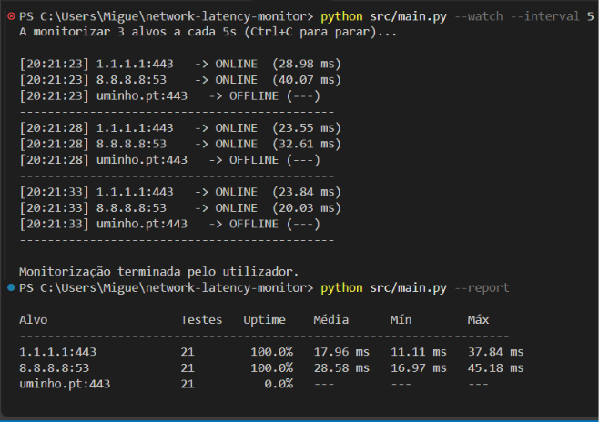

[🇵🇹 Versão em Português](README.pt.md)

# Network Latency & Availability Monitor

A Python command-line interface (CLI) tool to monitor the availability and TCP latency of network services and endpoints in real time, featuring local SQLite persistence and statistical reporting.


## Features

- **Continuous Monitoring (`--watch`)**: Periodically probes a list of targets via TCP sockets, measuring response time in milliseconds and gracefully handling timeouts or connection failures without crashing.
- **Local Persistence (`SQLite`)**: Logs every check (target, port, status, latency, and UTC timestamp) to a local database.
- **Historical Reporting (`--report`)**: Aggregates stored records via SQL to display total checks, uptime percentage, and average, minimum, and maximum latency per target.
- **Zero External Dependencies**: Built entirely with the Python Standard Library (`socket`, `time`, `sqlite3`, `argparse`, `unittest`).

## Demo



## Project Structure

```text
network-latency-monitor/
├── docs/
│   ├── architecture.png   # Application flow diagram
│   └── demo.png           # Terminal execution screenshot
├── src/
│   ├── prober.py          # TCP latency probing engine
│   ├── database.py        # SQLite management and SQL aggregation queries
│   └── main.py            # CLI interface (--watch and --report)
├── tests/
│   └── test_database.py   # Unit tests for SQL metrics
├── .gitignore
├── README.md
└── README.pt.md
```