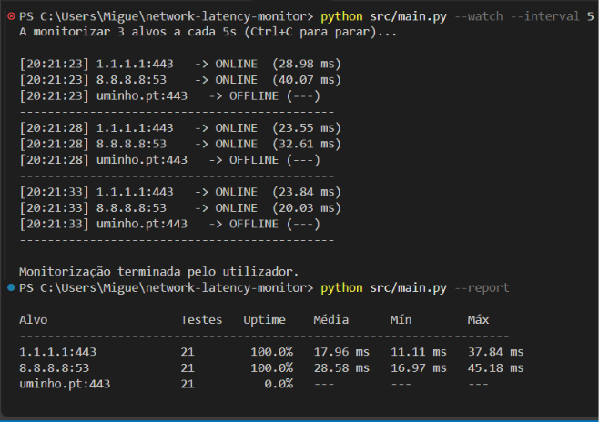

[🇬🇧 English Version](README.md)

# Network Latency & Availability Monitor

Ferramenta de linha de comandos (CLI) em Python para monitorizar a disponibilidade e a latência TCP de serviços e endereços de rede em tempo real, com persistência histórica em SQLite e geração de relatórios estatísticos.


## Funcionalidades

- **Monitorização Contínua (`--watch`)**: Verifica periodicamente uma lista de alvos via *sockets* TCP, medindo o tempo de resposta em milissegundos e tratando falhas ou *timeouts* sem interromper a execução.
- **Persistência Local (`SQLite`)**: Regista cada verificação (alvo, porta, estado, latência e *timestamp* UTC) numa base de dados local.
- **Relatório Histórico (`--report`)**: Agrega os dados guardados via SQL para apresentar o total de testes, percentagem de *uptime* e latências média, mínima e máxima por alvo.
- **Zero Dependências Externas**: Construído integralmente com a biblioteca padrão do Python (`socket`, `time`, `sqlite3`, `argparse`, `unittest`).

## Demonstração



## Estrutura do Projeto

```text
network-latency-monitor/
├── docs/
│   ├── architecture.png   # Diagrama de fluxo da aplicação
│   └── demo.png           # Captura de ecrã da execução no terminal
├── src/
│   ├── prober.py          # Motor de medição de latência TCP
│   ├── database.py        # Gestão da base de dados SQLite e queries SQL
│   └── main.py            # Interface CLI (--watch e --report)
├── tests/
│   └── test_database.py   # Testes unitários às métricas SQL
├── .gitignore
└── README.md
```